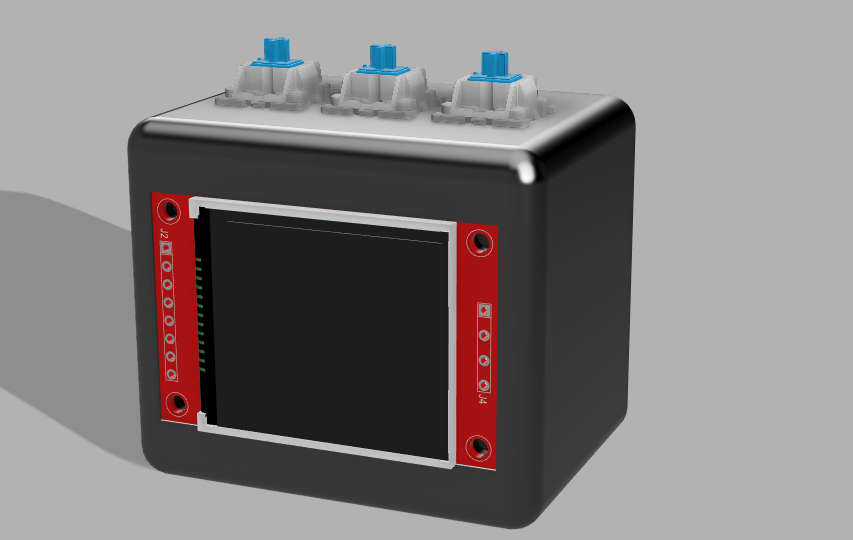
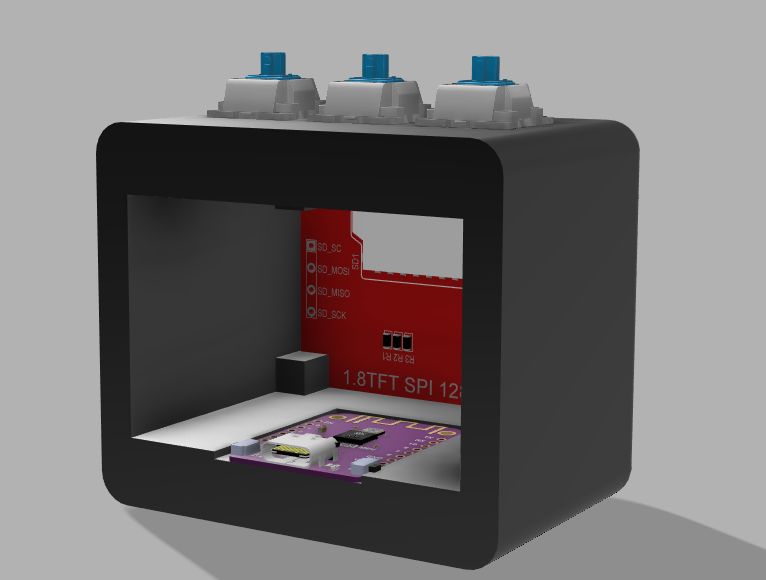
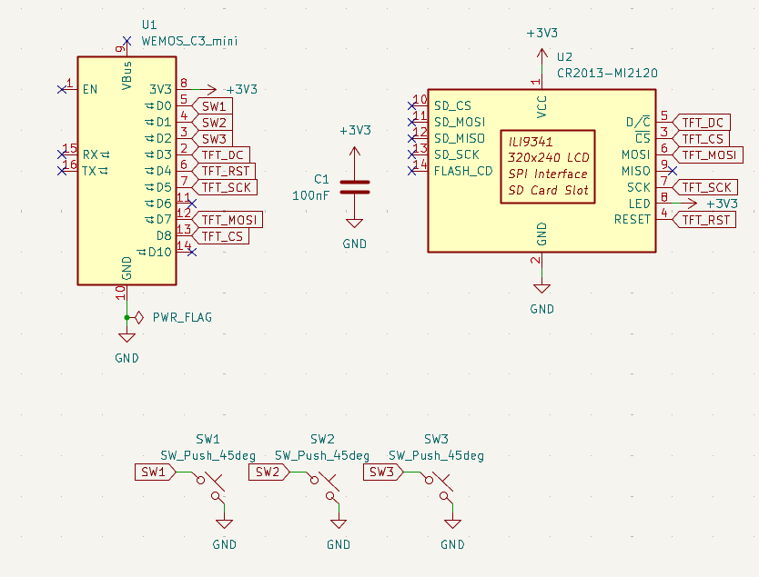
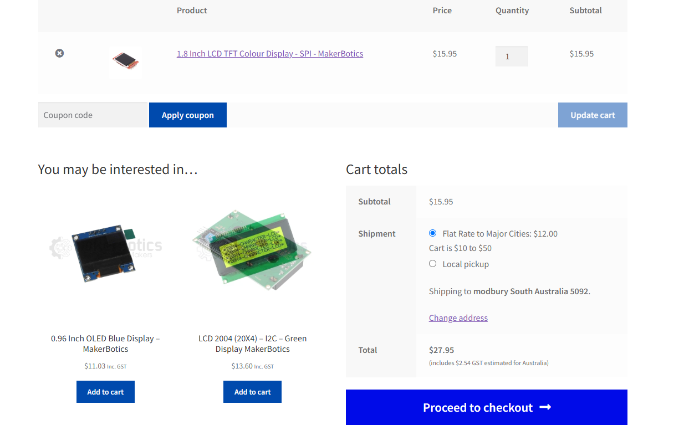
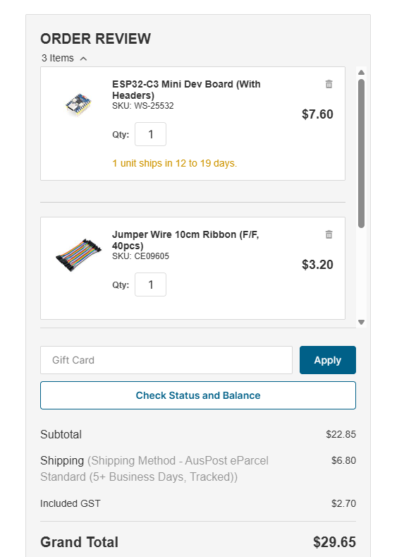
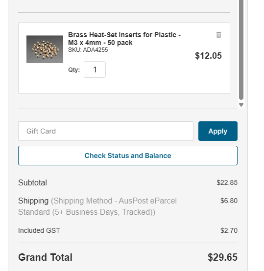

# SpotiDeck

A Deck that sits on your desktop and shows your currently playing spotify song using an ESP32 and Spotify's developer API. It includes a previous song, pause song and next song buttons using basic cherry MX Switches on the top and it all sits in a case. 

## Featues
- 3 Multimedia Keys
- A built in ESP32
- A front 1.8" display
- 3D printed case
- 4 Heatset inserts
- Designed for Cherry-MX Switches

## Renders
<table>
    <tr>
        <td></td>
        <td></td>
    </tr>
</table>

## Schematic Design

## Orders

<table>
  <tr>
    <td></td>
    <td></td>
    <td></td>
  </tr>
</table>

## BOM

|Product|Price|Quantity/MOQ|Subtotal|Links|
|-------|-----|------------|--------|-----|
|ESP32-C3-Mini (Core Electronics Australia - Grant)|A$7.60|1|A$7.60|[link](https://core-electronics.com.au/esp32-c3-mini-dev-board-risc-v-processor-wi-fi-bt5-smd-compatible.html)|
|Dupont Cables (Core Electronics Australia - Grant)|A$3.20|1|A$3.20|[link](https://core-electronics.com.au/female-to-female-dupont-line-40-pin-10cm-24awg.html)|
|ST7735 1.8 Inch LCD TFT Colour Display (Maker Store - Grant; Line Total Includes Shipping)|A$15.95|1|A$15.95|[link](https://www.makerstore.com.au/product/mb-elc-disp-tft-1d8/)|
|Heatset Inserts (Core Electronics Australia - Grant)|A$12.05|1|A$12.05|[link](https://core-electronics.com.au/brass-heat-set-inserts-for-plastic-m3-x-4mm-50-pack.html)|
|Core Electronics Shipping (Core Electronics Australia - Grant)||1|A$6.80||
|Maker Store Shipping (Maker Store - Grant)||1|A$12.00||
|3D Print (Printing Legion - Grant; From printing legion in slack)||1|A$17||
|Total||||A$74.60|